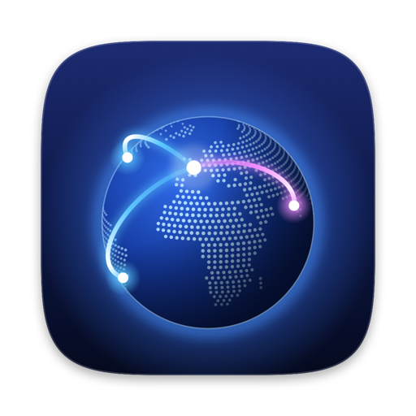
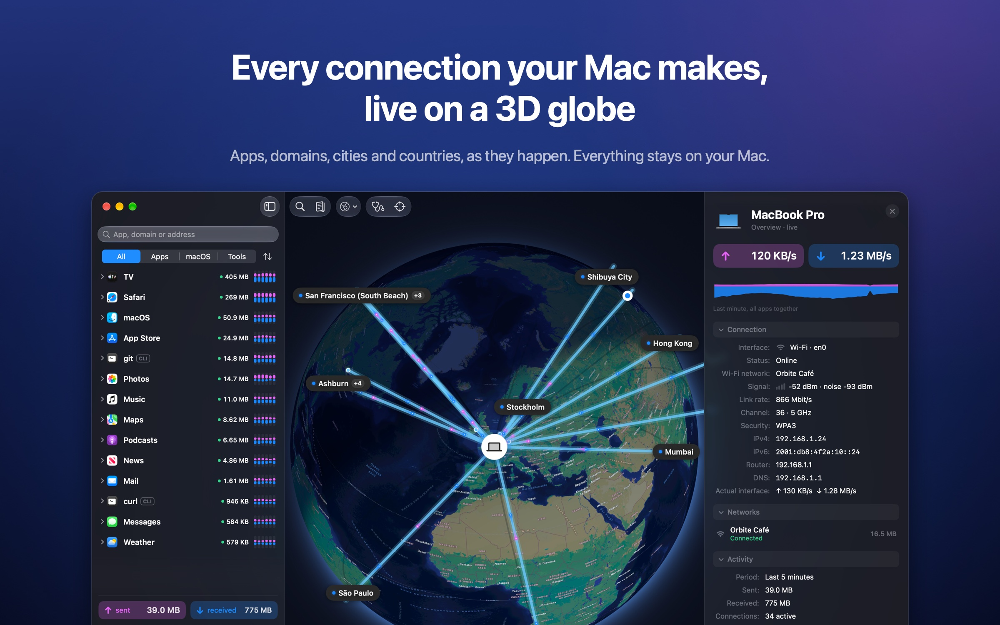

# Orbite

**Chaque connexion de ton Mac, en direct, sur une carte du monde et un globe 3D.**

Un moniteur réseau gratuit et open source pour macOS : quelle app parle à quel serveur, dans quelle ville et quel pays, combien elle envoie, et s'il y a des traqueurs ou du trafic en clair. Tout est calculé sur ton Mac.

[**Télécharger Orbite pour Mac**](https://github.com/MatisMLDR/Orbite/releases/latest/download/Orbite.dmg) · [English](README.md)

## Fonctions

- **Carte en direct du trafic réseau** : globe 3D avec le jour et la nuit, ou carte plane (plan, sobre, satellite, hybride), avec des comètes qui suivent les données.
- **Débit par app, par domaine et par pays** : domaines, processus, ports, protocoles, latence et signature de chaque app, y compris les services macOS et les outils en ligne de commande.
- **Vrais noms de domaine** grâce à un petit service facultatif qui lit les réponses DNS.
- **Traqueurs et trafic en clair** repérés avec les listes de DuckDuckGo, et une alerte sur les Wi-Fi ouverts.
- **Lieux** : ville, pays, organisation, distance et délai de la lumière jusqu'au serveur.
- **Bilan de la semaine** à partager, **journal des premières fois**, **replay de la journée**.
- **« Pourquoi c'est lent ? »** : box, Internet, signal Wi-Fi et apps gourmandes, vérifiés en quelques secondes.
- **Recherche ⌘K**, **barre des menus**, **widget**, **suivi des données mobiles**, **export CSV et JSON**, **Raccourcis**.
- En **français et en anglais**, selon la langue du Mac.

## Installation

1. [Télécharge `Orbite.dmg`](https://github.com/MatisMLDR/Orbite/releases/latest/download/Orbite.dmg). Il est signé avec un Developer ID et notarisé par Apple.
2. Ouvre-le et glisse **Orbite** dans **Applications**.
3. Au premier lancement, trois étapes facultatives : la base de géolocalisation (DB-IP Lite, environ 65 Mo), la localisation du Mac, et les vrais noms de domaine (autorisation admin dans Réglages Système › Général › Éléments de connexion et extensions).

Il faut macOS 26 Tahoe ou plus récent.

## Vie privée

Orbite observe sans jamais bloquer ni modifier le trafic. Pas de compte, pas de statistiques d'usage, pas de rapport de plantage. L'historique reste dans `~/Library/Application Support/Orbite`. Les adresses sont placées sur la carte avec la base installée sur le Mac, et les domaines comparés aux listes de traqueurs sur le Mac : aucune adresse ni aucun nom de domaine n'est envoyé. Le détail de ce qui sort du Mac est dans le [README anglais](README.md#privacy).

## Licence

[MIT](LICENSE) © 2026 Matis MLDR. Géolocalisation par [DB-IP](https://db-ip.com) (CC BY 4.0), listes de traqueurs de DuckDuckGo (CC BY-NC-SA 4.0).

Fait par [Matis MLDR](https://github.com/MatisMLDR).
