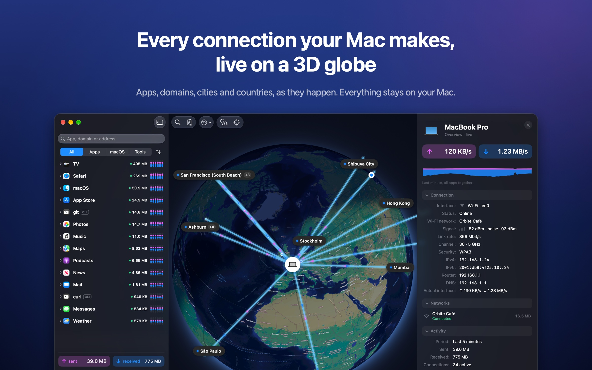
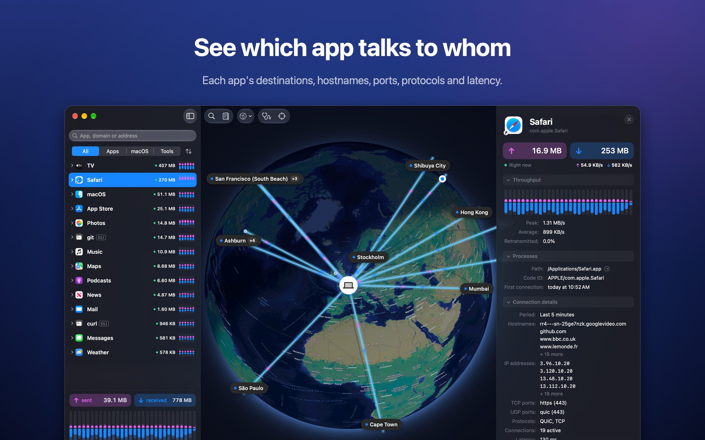
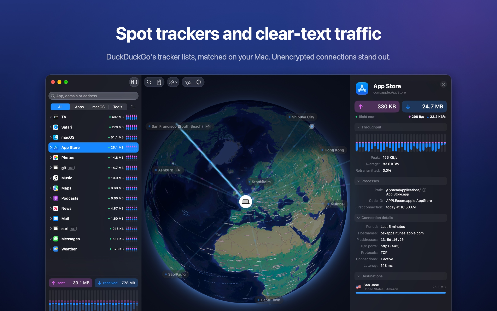
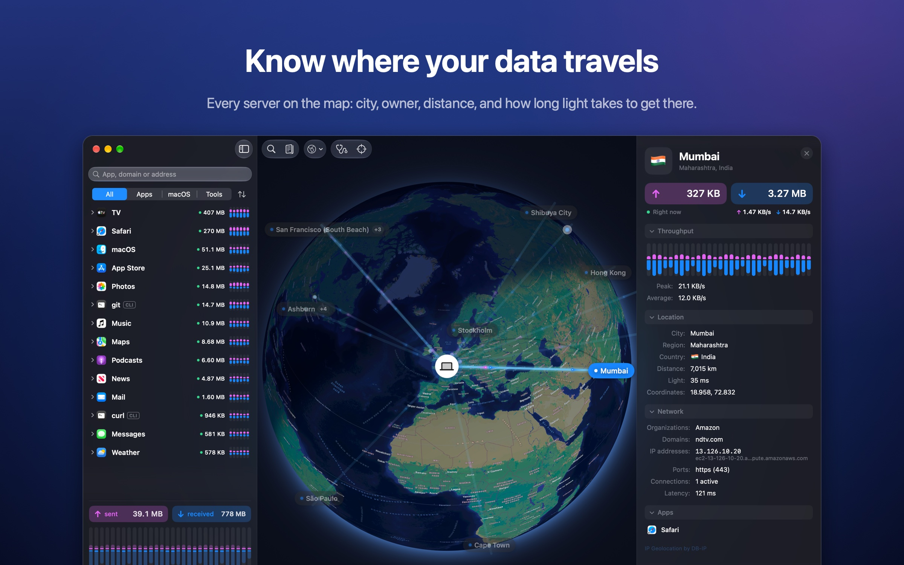
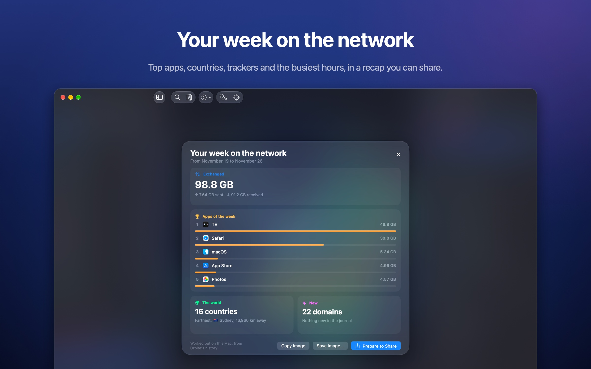
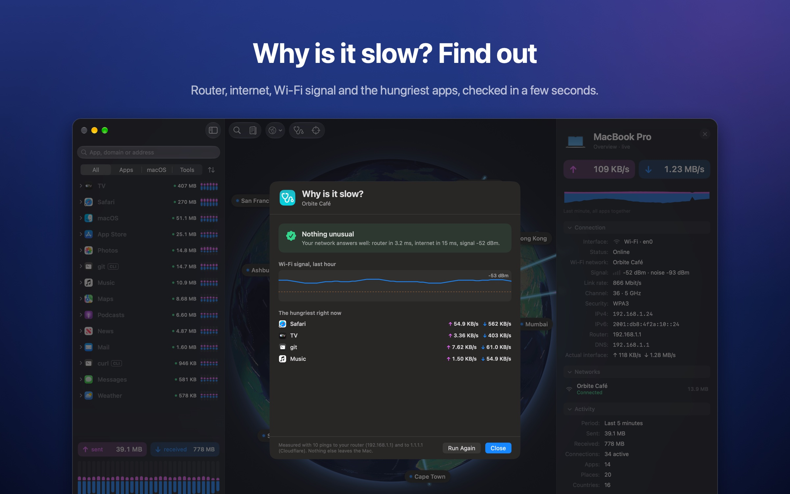
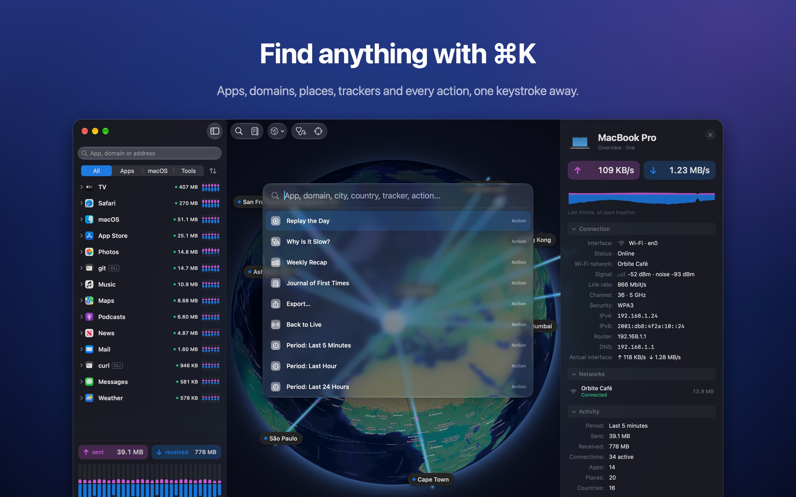

<div align="center">


# Orbite

**See every network connection your Mac makes, live on a world map and 3D globe.**

A free, open-source network monitor for macOS: which app talks to which server, in which city and country, how much it sends, and whether trackers or unencrypted traffic are involved. Everything is worked out on your Mac.

[](https://github.com/MatisMLDR/Orbite/releases/latest/download/Orbite.dmg)
[](#requirements)
[](https://www.swift.org)
[](LICENSE)
[](https://github.com/MatisMLDR/Orbite/releases)

[**Download Orbite for Mac**](https://github.com/MatisMLDR/Orbite/releases/latest/download/Orbite.dmg) · [Features](#features) · [Privacy](#privacy) · [FAQ](#faq) · [Build from source](#build-from-source) · [Version française](README.fr.md)



</div>

## Features

### A live map of your Mac's network traffic

Every connection is drawn from your Mac to the place it reaches, with comets that flow while data moves. Spin the **3D globe** with real day and night, or pick a flat map: standard, muted, satellite or hybrid. The bottom bar shows the upload and download rates, the open connections and how many places and countries you are talking to.

### Bandwidth per app, per domain and per country

The sidebar lists the apps that use the network, sorted by volume, upload or recent activity. Open an app to see its domains, its processes, ports, protocols, latency and code signature. macOS services and command-line tools (`curl`, `git`, `brew`…) get their own rows.



### Real domain names, not just IP addresses

An optional helper reads the DNS answers your Mac receives, so a connection shows as `youtube.com` instead of “Google”. Without it, Orbite still names each server by the network that owns it.

### Trackers and clear-text traffic stand out

Domains from DuckDuckGo's Tracker Radar lists are tagged as advertising, analytics, social, fingerprinting or telemetry, with their owner and how widespread they are. Connections that travel unencrypted (HTTP, FTP, Telnet, POP3, IMAP, public DNS) are flagged, and Orbite warns you when that happens on an open Wi-Fi.



### Know where your data travels

Select a place to see its city, region and country, the organizations behind its servers, the distance from your Mac and the time light needs to get there.



### Your week on the network

A weekly recap sums it up: total traffic, the apps of the week, countries, new domains, trackers, the busiest hour and the night owl. Share it as an image.



### “Why is it slow?”

One click pings your router and the internet, reads the Wi-Fi signal, noise and band, finds the app saturating your link or the one destination that is slow, and tells you in plain words where the problem is.



### And also

- **Journal of first times**: a new app, a new domain, a new country, an unusual upload, what happened while you were away.
- **Replay the day** on the map, 24 hours in a minute.
- **⌘K search** across apps, domains, organizations, cities, countries, trackers, networks and actions.
- **Menu bar item** with live rates or a mini graph, and a panel with what is talking right now.
- **Desktop widget** with today's traffic.
- **Mobile data tracking** for Personal Hotspot and cellular, with your plan's quota and reset day.
- **Wi-Fi and network details**: signal, channel, security, IPv4, IPv6, router, DNS, VPN and iCloud Private Relay.
- **Export** to CSV or JSON, **Shortcuts** actions and `orbite://` links.
- In **English and French**.



## Install

1. [Download `Orbite.dmg`](https://github.com/MatisMLDR/Orbite/releases/latest/download/Orbite.dmg). It is signed with a Developer ID and notarized by Apple.
2. Open it and drag **Orbite** to **Applications**.
3. On first launch, the welcome card offers three steps, all optional:
   - **Download the geolocation database** (DB-IP Lite, about 65 MB, refreshed monthly) so servers appear on the map.
   - **Allow Location Services** so the map starts from where your Mac is. Otherwise Orbite uses your time zone's city.
   - **Turn on real domain names**. macOS asks for an admin approval in System Settings › General › Login Items & Extensions.

### Requirements

- macOS 26 Tahoe or later.
- Apple silicon or Intel (universal app).

## Privacy

Orbite only watches; it never blocks or changes your traffic. It has no account, no analytics and no crash reporting. Your history (7 days of volumes, 30 days of journal) stays in `~/Library/Application Support/Orbite`.

What Orbite itself sends over the network:

| What | Where | When |
| --- | --- | --- |
| Geolocation database download | `download.db-ip.com` | Once a month |
| Tracker lists download | `staticcdn.duckduckgo.com`, `raw.githubusercontent.com` | Once a week |
| Map tiles | Apple Maps | While a map is on screen |
| Pings | Your router and `1.1.1.1` | Only while a diagnosis runs |
| Reverse DNS lookups | Your DNS resolver | When an inspector lists IP addresses |

Addresses are placed on the map with the database on your Mac, and domains are matched against the tracker lists on your Mac: no address or domain name is ever sent out to be looked up.

## How it works

- **Traffic**: Orbite reads `nettop` once a second, without admin rights, and attributes each process to its app with `libproc`. XPC services count for the app that owns them.
- **Domain names**: the optional helper is a small launch daemon, registered with `SMAppService`. It runs as root only to capture DNS answers (UDP port 53) with `libpcap`. It keeps them in memory, writes nothing to disk, makes no network request and answers only Orbite, after checking its code signature. See [SECURITY.md](SECURITY.md).
- **Places**: [DB-IP Lite](https://db-ip.com) City and ASN databases, read by Orbite's own MaxMind DB reader.
- **Maps**: Apple MapKit for the flat maps; a custom Metal renderer for the 3D globe and its day and night shading.
- **Interface**: SwiftUI with Liquid Glass, Swift 6 with strict concurrency.

## FAQ

**Is Orbite a firewall?**
No. Orbite shows what your Mac does on the network and never blocks anything. To block connections, use [LuLu](https://objective-see.org/products/lulu.html) or [Little Snitch](https://www.obdev.at/products/littlesnitch).

**Why does Orbite ask for admin rights?**
Only for real domain names: capturing DNS answers needs root. Everything else works without it.

**Why do some connections show a company name instead of a domain?**
Without the helper, or when an app uses encrypted DNS (DNS over HTTPS, iCloud Private Relay), Orbite cannot see the domain and names the network that owns the server instead.

**Is it free?**
Yes, and open source under the MIT license.

## Build from source

You need Xcode 26 or later and [XcodeGen](https://github.com/yonaskolb/XcodeGen) (`brew install xcodegen`).

1. In `project.yml`, set `DEVELOPMENT_TEAM` to your team ID. Without a Developer ID certificate, set `CODE_SIGN_IDENTITY` to `"Apple Development"`. The app and its helper trust each other through that team only.
2. Generate the project and build:

   ```sh
   xcodegen generate
   open Orbite.xcodeproj
   ```

   Or run `scripts/build-app.sh` to build, install in `/Applications` and launch.
3. Run the tests with `xcodebuild test -project Orbite.xcodeproj -scheme Orbite`.

In Debug builds, set `ORBITE_DEMO=1` to fill Orbite with a made-up week of traffic instead of your own (see `Orbite/Demo/DemoMode.swift`). `scripts/screenshots.sh` uses it for the images above.

## Credits

- IP geolocation by [DB-IP](https://db-ip.com), licensed under [CC BY 4.0](https://creativecommons.org/licenses/by/4.0/).
- Tracker lists from DuckDuckGo's [Tracker Radar](https://github.com/duckduckgo/tracker-radar) and [App Tracking Protection](https://github.com/duckduckgo/tracker-blocklists) lists, licensed under [CC BY-NC-SA 4.0](https://creativecommons.org/licenses/by-nc-sa/4.0/). They are downloaded at run time, not shipped with the app.
- Maps by Apple MapKit.

## License

[MIT](LICENSE) © 2026 Matis MLDR.

Made by [Matis MLDR](https://github.com/MatisMLDR). If Orbite is useful to you, a ⭐ helps others find it.
